### ✈ Now boarding

I'm **Mohab Badawy**, an **Electrical & Computer Engineering** junior at the **American University in Cairo** (class of '28) and co-founder & General Manager of **[Solven](https://solvenhq.com)**, a software and AI automation company working with businesses across **Egypt and the GCC**.

I think from both sides of the table. First: *what is this problem costing the business?* Then: *what's the cleanest system that makes it go away?* That's how I build websites, apps, automations and AI agents for real clients, and products like **[Nudge](https://studynudge.app)** for students.

Grew up in **Kuwait** · based in **Cairo** · building for the **GCC**.

### 🎫 Your tickets

  
  
  
  

### 🛂 Passport

### 🗺 Itinerary

| When | Where | What |
|:-----|:------|:-----|
| **2026 →** | **[Solven](https://solvenhq.com)** · Cairo | Co-founder & General Manager. Software, automation and AI agents for SMEs in Egypt and the GCC. Sales, proposals, product and delivery. |
| **2026 →** | **[Nudge](https://studynudge.app)** | Co-founder. Study-planning app for university students, in web beta and pitching at AUC. |
| **Jul 2026** | **Dubizzle** · IT | IT intern across security tooling (CrowdStrike, FortiGate, FortiAnalyzer), network infrastructure and telephony. Presented a telephony comparison brief to the IT team. |
| **Earlier** | **QNB Alahli** · **SIAC Construction** | Internships |
| **AUC** | Al Quds club | Co-head of events |
| **AUC** | Teaching | A-Level Mathematics assistant (part-time) |
| **2024 → 2028** | **American University in Cairo** | B.Sc. Electrical & Computer Engineering · GPA 3.72 · 50% first-year merit award |

<b>🧳 Carry-on (full toolkit)</b>

 

| | |
|:--|:--|
| **Languages** | Python · C · C++ · TypeScript |
| **Web & product** | Next.js · React · FastAPI · REST APIs |
| **Automation & AI** | n8n · API integrations · multi-agent AI systems · HubSpot CRM |
| **Cloud** | AWS · Microsoft Azure · Vercel · Render |
| **Infra & security** | Linux · Git · networking · FortiGate · FortiAnalyzer · CrowdStrike |
| **Business** | Outbound sales · client proposals · product specs · CRM operations |
| **Certifications** | ✅ AZ-900 · 🛫 AWS Cloud Practitioner → Solutions Architect · 🛫 Terraform Associate |
| **Languages (human)** | English (IELTS 8.0) · Arabic |

### 📡 Contact the crew

[LinkedIn](https://www.linkedin.com/in/mohab-badawy-auc/) · [mohab@solvenhq.com](mailto:mohab@solvenhq.com) · [solvenhq.com](https://solvenhq.com) · [studynudge.app](https://studynudge.app)

Off duty: PS5 · football · travel &nbsp;·&nbsp; Issued in Cairo &nbsp;·&nbsp; Valid for all destinations
