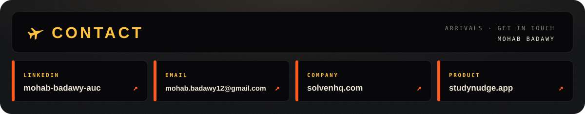

<a href="https://www.linkedin.com/in/mohab-badawy-auc/">LinkedIn</a> &nbsp;·&nbsp; <a href="mailto:mohab.badawy12@gmail.com">Email</a> &nbsp;·&nbsp; <a href="https://solvenhq.com">Solven</a> &nbsp;·&nbsp; <a href="https://studynudge.app">Nudge</a>

