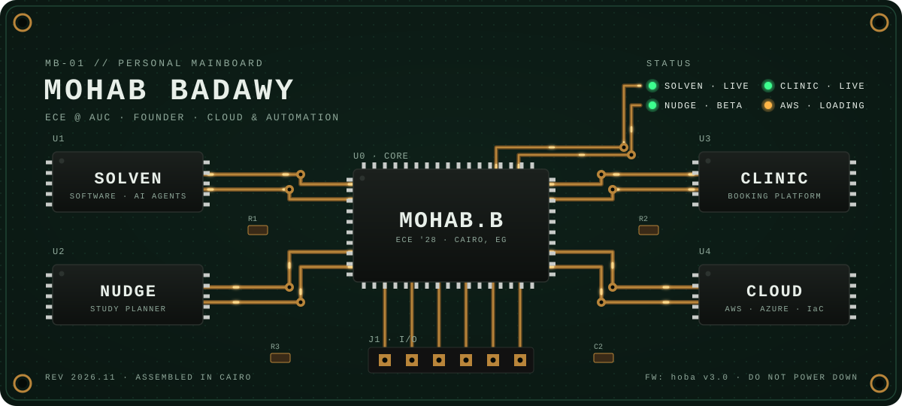
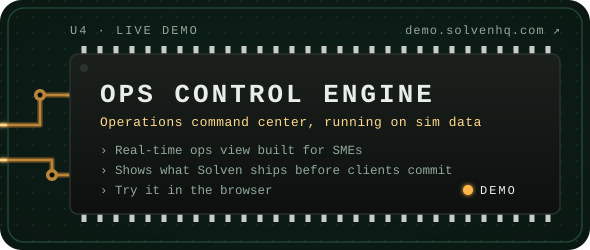

<div align="center">
  
</div>



### `> whoami`

I'm **Mohab**, an **Electrical & Computer Engineering** junior at **AUC** and co-founder & GM of **[Solven](https://solvenhq.com)**, a Cairo-based software and AI automation company working with businesses across Egypt and the GCC.

I sit where business and software meet: I start from what a problem is costing a business, then engineer the system that makes it go away. Grew up in **Kuwait**, building from **Cairo**.

### `> cat operating_principles.md`

```diff
+ 01  Start with the business problem. Pick the stack after.
+ 02  If it costs time or money every week, automate it.
+ 03  Ship to real users early. Real feedback beats perfect plans.
```


### `> ls ./mounted-components`

<p align="center">
  <a href="https://solvenhq.com"></a>
  <a href="https://studynudge.app"></a>
  <a href="https://dralaahussien.com"></a>
  <a href="https://demo.solvenhq.com"></a>
</p>

### `> watch ./activity`




### `> cat bill_of_materials.csv`

| Ref | Part | Value |
|:---:|:-----|:------|
| `L1` | Languages | Python · C · C++ · TypeScript |
| `F1` | Frameworks | Next.js · React · FastAPI |
| `A1` | Automation & AI | n8n · API integrations · multi-agent systems · HubSpot CRM |
| `C1` | Cloud | AWS · Microsoft Azure · Vercel · Render |
| `T1` | Tooling | Git · Linux · Terraform *(learning)* · Claude Code |
| `S1` | Infra & Security | Hands-on with CrowdStrike · FortiGate · FortiAnalyzer · enterprise networking |
| `B1` | Business | Outbound sales · client proposals · product specs · CRM ops |

### `> cat firmware_roadmap.md`

```diff
+ [done]     AZ-900 · Microsoft Azure Fundamentals
+ [done]     IT internship @ Dubizzle: infra, security tooling, telephony
! [running]  AWS Cloud Practitioner → AWS Solutions Architect Associate
! [running]  HashiCorp Terraform Associate
! [running]  Solven → registered company + more clients across the GCC
! [running]  Nudge → public launch on the App Store + Google Play
```

<details>
<summary><b><code>> cat datasheet.txt</code></b>: revision history &amp; operating conditions</summary>

<br/>

**Revision history**

| Rev | Date | Change |
|:---:|:-----|:-------|
| `3.0` | 2026 | Co-founded **Solven** · General Manager |
| `2.4` | Jul 2026 | IT Intern @ **Dubizzle** |
| `2.0` | 2026 | Co-founded **Nudge** |
| `1.5` | — | Internships @ **QNB Alahli** · **SIAC Construction** |
| `1.0` | 2024 | Booted at **AUC** · 50% merit award · ECE |
| `0.1` | — | Firmware written in **Kuwait** |

**Recommended operating conditions**

| Parameter | Value |
|:----------|:------|
| Location | Cairo, EG · UTC+2 |
| Languages (human) | English · Arabic |
| Idle mode | PS5 · football · travel |
| Interrupts | Matchday overrides everything |

</details>


### `> cat pinout.txt`

| Pin | Signal | Connect |
|:---:|:-------|:--------|
| `1` | LinkedIn | [linkedin.com/in/mohab-badawy-auc](https://www.linkedin.com/in/mohab-badawy-auc/) |
| `2` | Email | [mohab@solvenhq.com](mailto:mohab@solvenhq.com) |
| `3` | Company | [solvenhq.com](https://solvenhq.com) |
| `4` | Product | [studynudge.app](https://studynudge.app) |

<sub><code>MB-01 · REV 3 · assembled in Cairo · do not power down</code></sub>
