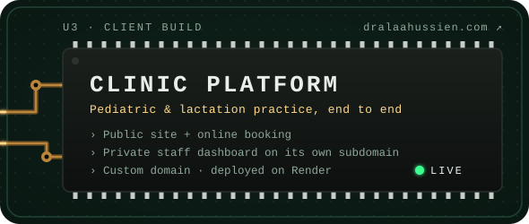

<div align="center">
  
</div>


### `> whoami`

I'm **Mohab** (`hoba` in the terminal), an **Electrical & Computer Engineering** junior at **AUC** and co-founder of **[Solven](https://solvenhq.com)**, a Cairo-based software and AI automation company working with businesses across Egypt and the GCC.

I like systems that actually run: real clients, real deployments, real users. Raised between **Kuwait** and **Cairo**, building for both.


### `> ls ./mounted-components`

<p align="center">
  <a href="https://solvenhq.com"></a>
  <a href="https://studynudge.app"></a>
  <a href="https://dralaahussien.com"></a>
  <a href="https://demo.solvenhq.com"></a>
</p>


### `> cat bill_of_materials.csv`

| Ref | Part | Value |
|:---:|:-----|:------|
| `L1` | Languages | Python · C · C++ · TypeScript |
| `F1` | Frameworks | Next.js · FastAPI · React |
| `A1` | Automation | n8n · API integrations · AI agents · HubSpot |
| `C1` | Cloud | AWS · Microsoft Azure · Vercel · Render |
| `T1` | Tooling | Git · Linux · Terraform *(learning)* · Claude Code |
| `S1` | Security & Infra | Exposure to CrowdStrike · FortiGate · FortiAnalyzer · enterprise networking |

### `> cat firmware_roadmap.md`

```diff
+ [done]     AZ-900 · Microsoft Azure Fundamentals
+ [done]     IT internship @ Dubizzle — infra, security tooling, telephony
! [running]  AWS Cloud Practitioner → AWS Solutions Architect Associate
! [running]  HashiCorp Terraform Associate
! [running]  Nudge → public launch + App Store / Google Play
# [queued]   DevOps / platform engineering in the GCC
```

<details>
<summary><b><code>> cat datasheet.txt</code></b> — revision history &amp; operating conditions</summary>

<br/>

**Revision history**

| Rev | Date | Change |
|:---:|:-----|:-------|
| `3.0` | 2026 | Co-founded **Solven** · General Manager |
| `2.4` | Jul 2026 | IT Intern @ **Dubizzle** |
| `2.0` | 2026 | Co-founded **Nudge** |
| `1.5` | — | Internships @ **QNB Alahli** · **SIAC Construction** |
| `1.0` | 2024 | Booted at **AUC** · 50% merit award · ECE |

**Recommended operating conditions**

| Parameter | Value |
|:----------|:------|
| Location | Cairo, EG · UTC+2 |
| Languages (human) | English · Arabic |
| Idle mode | PS5 · football · travel |
| Max throughput | Late nights with a deploy queued |

</details>


### `> cat pinout.txt`

| Pin | Signal | Connect |
|:---:|:-------|:--------|
| `1` | LinkedIn | [linkedin.com/in/mohab-badawy-auc](https://www.linkedin.com/in/mohab-badawy-auc/) |
| `2` | Email | [mohab@solvenhq.com](mailto:mohab@solvenhq.com) |
| `3` | Company | [solvenhq.com](https://solvenhq.com) |
| `4` | Product | [studynudge.app](https://studynudge.app) |

<sub><code>MB-01 · REV 2026.11 · assembled in Cairo · do not power down</code></sub>
